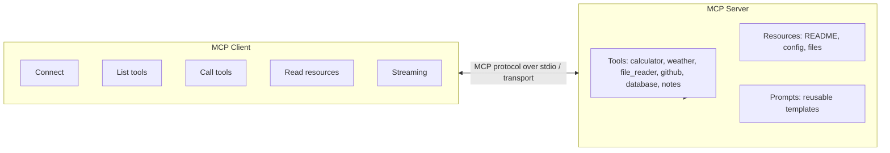

# mcp-server-client

A full **Model Context Protocol (MCP)** implementation — a server that exposes
tools, resources, and reusable prompt templates, plus a client that connects,
discovers, and invokes them. The goal is to understand MCP end-to-end: how a
server advertises capabilities and how a client discovers and calls them.

> Status: **scaffold**. Modules are skeletons with `TODO` markers referencing the
> project checklist. No feature logic is implemented yet.

---

## Architecture Diagram



---

## Folder Structure

```
mcp-server-client/
├── server/
│   ├── __init__.py
│   ├── server.py              # MCP server entrypoint (stub)
│   ├── tools/
│   │   ├── __init__.py
│   │   ├── calculator.py
│   │   ├── weather.py
│   │   ├── file_reader.py
│   │   ├── github.py
│   │   ├── database.py
│   │   └── notes.py
│   ├── resources/
│   │   ├── __init__.py
│   │   └── resources.py       # README / config / files resources
│   ├── prompts/
│   │   ├── __init__.py
│   │   └── prompts.py         # reusable prompt templates
│   ├── requirements.txt       # mcp, pydantic
│   └── Dockerfile
├── client/
│   ├── __init__.py
│   ├── client.py              # connect / list / call / read / stream (stub)
│   └── requirements.txt       # mcp
├── config/
│   └── config.example.json    # copy to config.json and fill in
├── docker-compose.yml         # server service
├── .gitignore
├── LICENSE
└── README.md
```

---

## Installation Guide

### With Docker (recommended)

```bash
docker compose up
```

This builds and runs the MCP **server** service. Configuration is mounted from
`./config` — copy the example first:

```bash
cp config/config.example.json config/config.json
# edit config/config.json with your values
```

### Local (manual)

```bash
# Server
pip install -r server/requirements.txt
python -m server.server

# Client (separate shell)
pip install -r client/requirements.txt
python -m client.client
```

> Note: dependencies are declared as manifests. Install them yourself; the
> scaffold does not install anything for you.

---

## Features

- **Server tools:** calculator, weather, file reader, GitHub, database, notes.
- **Server resources:** README, config, and files exposed over MCP.
- **Server prompts:** reusable, parameterized prompt templates.
- **Client:** connect to a server, list tools, call tools, read resources, and
  consume streaming responses.
- **Runs with `docker compose up`.**

---

## Screenshots

_Coming soon_

---

## Demo GIF

_Coming soon_

---

## API Documentation

MCP capabilities exposed by the server:

| Kind     | Name        | Description                                  |
|----------|-------------|----------------------------------------------|
| Tool     | calculator  | Basic arithmetic / expression evaluation     |
| Tool     | weather     | Current weather / forecast for a location    |
| Tool     | file_reader | Read files from an allowlisted directory     |
| Tool     | github      | Query repos, issues, and PRs                 |
| Tool     | database    | Run parameterized read queries               |
| Tool     | notes       | Create, list, read, and delete notes         |
| Resource | README      | Project README as a readable resource        |
| Resource | config      | Effective server configuration               |
| Resource | files       | Files under the configured root              |
| Prompt   | templates   | Reusable prompt templates                    |

Detailed request/response protocol docs: _Coming soon_

---

## Future Improvements

- Implement all tool, resource, and prompt handlers (see project checklist).
- Add a `client` service to `docker-compose.yml` for an end-to-end demo.
- Authentication and secrets management for the GitHub / weather / database tools.
- Automated tests and CI.
- Pin base image and dependency versions.

---

## License

Released under the [MIT License](./LICENSE). Copyright (c) 2026 ranjan-del.
