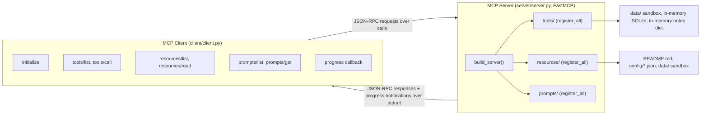

# mcp-server-client

| | |
|---|---|
| **What it is** | A complete Model Context Protocol implementation: a server exposing all three primitives, and a client that discovers and calls them over stdio |
| **Stack** | Python · MCP SDK · SQLite (in-memory) · stdio transport |
| **Run it** | `docker compose up --build`, or `python client/main.py` to drive the server directly |
| **Tests** | 45 (pytest), run in CI on every push |
| **Read first** | `server/` for the primitives, then `client/` for the discovery-and-call sequence |

**Why it is worth reading:** MCP is easy to describe in a paragraph and surprisingly fiddly in practice. This implements tools, resources *and* prompt templates rather than only tools, and the client watches progress notifications stream back from a long-running call, which is the part most examples skip.

A complete, runnable **Model Context Protocol (MCP)** implementation in Python: a server that exposes
all three MCP primitives (tools, resources and prompt templates) and a client that connects to it over
the stdio transport, discovers what it offers, calls it, and watches progress notifications stream back.
It exists as a learning artifact. MCP is easy to describe in a paragraph and surprisingly fiddly to
internalise, so this repo builds both halves of the conversation side by side, small enough to read in
one sitting and honest enough to run offline with no API keys and no accounts.

## What you'll learn

- The three MCP primitives and how they differ: **tools** (actions the client invokes), **resources**
  (readable data addressed by URI, like a GET endpoint) and **prompts** (parameterised message templates).
- How `FastMCP` turns an ordinary type-hinted Python function into a JSON-RPC method with an
  auto-generated input schema.
- What the **stdio transport** actually is: the client spawns the server as a subprocess and speaks
  JSON-RPC over its stdin/stdout, so there is no port and no HTTP.
- The full client lifecycle: `initialize` handshake, `tools/list`, `tools/call`, `resources/list`,
  `resources/read`, `prompts/list`, `prompts/get`.
- What "streaming" means in MCP: the result of a call still arrives in one response, but the server can
  emit `notifications/progress` messages while the call is in flight, and the client receives them
  through a progress callback.
- **Resource templates** (`files://{name}`) and why they do not appear in `resources/list`.
- Writing tools that are safe to expose to an untrusted caller: AST-whitelist arithmetic instead of
  `eval`, a resolved-path sandbox instead of naive path joining, bound SQL parameters instead of string
  formatting, and config redaction before anything crosses the wire.
- Offline-first design: deterministic hash-derived stubs so demos and tests never depend on a network.

## Architecture



The important structural point: the client **launches** the server (`python -m server.server`) as a
child process. Nothing listens on a socket. `build_server()` in `server/server.py` is a thin wiring
layer that calls three `register_all()` functions, one per primitive package, and each of those walks
its own modules calling their `register(mcp)` hook.

## Tech stack

| Component | Technology | Why this choice |
|---|---|---|
| Protocol server | `mcp` Python SDK, `FastMCP` (`server/server.py`) | The official SDK. `FastMCP` derives JSON schemas from type hints, so a tool is just a decorated function and the repo stays about MCP concepts rather than JSON-RPC plumbing. |
| Protocol client | `mcp.ClientSession` + `mcp.client.stdio.stdio_client` (`client/client.py`) | Same SDK, client half. Using the real client rather than hand-rolled JSON-RPC proves the server is genuinely spec-compliant. |
| Transport | stdio (subprocess stdin/stdout) | The MCP default for local servers, and what Claude Desktop and similar hosts use. No ports, no TLS, no auth surface. |
| Async runtime | `asyncio` (stdlib), via `anyio` inside the SDK | The MCP session is inherently concurrent: progress notifications arrive while a call is still pending. |
| Expression evaluation | `ast` (stdlib) in `server/tools/calculator.py` | Parsing to an AST and whitelisting node types gives a real evaluator with none of `eval`'s remote-code-execution risk. |
| Database tool | `sqlite3` (stdlib) in `server/tools/database.py` | Zero-install, in-memory by default, and enough to demonstrate parameterised queries. |
| Determinism for offline stubs | `hashlib` (stdlib) in `weather.py` and `github.py` | Hashing the input means the same city or repo always yields the same fake data, so tests assert exact values without flaking. |
| Optional live API calls | `httpx` (pulled in by `mcp`) | Already a transitive dependency, so the optional live path adds no new install. |
| Tests | `pytest` | Plain functions, no fixture ceremony. Includes real subprocess round trips, not only unit tests. |
| CI | GitHub Actions (`.github/workflows/ci.yml`) | Runs the suite on Python 3.11, 3.12 and 3.13 on every push and pull request. |
| Containers | Docker and Docker Compose | Provided for reproducibility. See the honesty note in Limitations: Docker was not available in the environment this was built in. |

## Folder structure

```
mcp-server-client/
├── server/
│   ├── __init__.py            # package docstring only; keeps imports circular-free
│   ├── server.py              # build_server() + main(); wires everything, runs stdio
│   ├── tools/
│   │   ├── __init__.py        # register_all(): calls register() on every tool module
│   │   ├── calculator.py      # AST-whitelist arithmetic evaluator
│   │   ├── weather.py         # deterministic offline weather; optional live API
│   │   ├── file_reader.py     # sandboxed reads + chunked streaming reader
│   │   ├── github.py          # deterministic offline repo info; optional live API
│   │   ├── database.py        # RecordsDB, a tiny SQLite store
│   │   └── notes.py           # NotesStore, in-memory CRUD
│   ├── resources/
│   │   ├── __init__.py        # register_all() wrapper
│   │   └── resources.py       # docs://readme, config://server, files://list, files://{name}
│   ├── prompts/
│   │   ├── __init__.py        # register_all() wrapper
│   │   └── prompts.py         # summarize + code_review templates
│   ├── requirements.txt       # runtime deps for the server half
│   └── Dockerfile             # server-only image
├── client/
│   ├── __init__.py
│   ├── client.py              # the end-to-end demo: connect, list, call, read, stream
│   └── requirements.txt
├── tests/                     # pytest suite, one file per module + streaming + server
├── data/                      # sandbox root for file_reader (sample.txt, notes.txt)
├── config/config.example.json # copy to config.json for real keys; never commit secrets
├── Dockerfile                 # full-demo image (runs the client, which spawns the server)
├── docker-compose.yml         # `docker compose up` runs that demo
├── .github/workflows/ci.yml   # pytest on 3.11/3.12/3.13
├── LICENSE                    # MIT
└── README.md
```

## Codebase walkthrough

### Entrypoint: `server/server.py`

Two functions and nothing else. `build_server()` constructs `FastMCP("mcp-server-client")` and calls
`register_tools(mcp)`, `register_resources(mcp)` and `register_prompts(mcp)` in that order, then returns
the configured instance. `main()` calls `build_server()` and then `server.run(transport="stdio")`.

The split matters: because `build_server()` never starts the event loop, tests can build the whole
server in-process and introspect it. `tests/test_server.py::test_build_server_registers_everything`
does exactly that, awaiting `mcp.list_tools()` directly. `main()` is the only code that assumes a
transport.

### The registration pattern

Every feature package follows the same two-level shape, and understanding it once explains all of
`server/`:

1. Each leaf module (for example `server/tools/calculator.py`) defines **pure functions or classes**
   with no MCP awareness at all (`calculate()`, `RecordsDB`, `build_summarize_prompt()`), plus a single
   `register(mcp)` function at the bottom that wraps them in `@mcp.tool()`, `@mcp.resource()` or
   `@mcp.prompt()` decorated closures.
2. Each package `__init__.py` exposes `register_all(mcp)`, which loops over its modules calling
   `register`. `server/tools/__init__.py` keeps an explicit ordered `_MODULES` tuple so the server
   advertises tools in a stable, readable order rather than whatever import order happens to be.

The payoff is testability. The pure layer is unit-tested directly with no protocol involved, and the
MCP layer is a thin adapter tested once end to end.

### Tools: `server/tools/`

**`calculator.py`.** `calculate(expression)` runs `ast.parse(expression, mode="eval")` and then walks
the tree with `_eval_node()`, which accepts only `ast.Constant` numbers, `ast.BinOp` whose operator is
in the `_BINARY_OPS` whitelist (`+ - * / // % **`), and `ast.UnaryOp` with `_UNARY_OPS` (unary plus and
minus). Every other node type, including `Name`, `Call` and `Attribute`, raises `CalculatorError`.
`mode="eval"` already rules out statements, imports and semicolons; the whitelist closes the rest.
`register()` wraps it as the `calculator` tool, returning a formatted `"<expr> = <result>"` string.

**`weather.py`.** `get_weather(city)` validates the city, then branches: if `WEATHER_API_KEY` is set it
tries `_get_weather_live()` (an `httpx.get` against a WeatherAPI-style endpoint) inside a broad
`try/except` that deliberately swallows failures, otherwise, or on any failure, it returns
`_deterministic_weather(city)`. That stub takes `sha256(city.lower())`, converts the digest to an int
and slices it into a temperature, a condition drawn from `_CONDITIONS`, a humidity and a wind speed.
Same city in, same numbers out, forever.

**`github.py`.** Structurally identical to `weather.py`, which is the point: it shows the offline-stub
pattern is a pattern, not a one-off. `get_repo_info(owner, repo)` returns `_deterministic_repo()` unless
`GITHUB_TOKEN` is set, in which case `_get_repo_info_live()` hits `api.github.com/repos/{owner}/{repo}`
and degrades back to the stub on error.

**`file_reader.py`.** The security-critical module, and also where streaming lives.
`_default_base_dir()` resolves the repo's `data/` directory. `_safe_target(relative_path, base_dir,
max_bytes)` is the single security choke point: it joins the request onto the base, calls `.resolve()`
(which collapses `..` and follows symlinks so the check sees the real target), then rejects anything
where `candidate.is_relative_to(base)` is false, followed by existence, regular-file and size checks.
`read_file()` and `iter_file_chunks()` both go through it, so the traversal defence cannot drift between
them. `iter_file_chunks()` yields `(chunk_text, chars_read_so_far, total_chars)` tuples of
`DEFAULT_CHUNK_SIZE` (32) characters, and yields one empty event for an empty file so consumers never
have to special-case zero progress. `list_files()` walks the sandbox with `rglob`.

`register()` exposes two tools. `file_list` is trivial. `file_reader` is `async` and takes
`ctx: Context`: FastMCP recognises that annotation, injects the request context, and hides the
parameter from the public schema, so callers still pass only `relative_path`. The body loops over
`iter_file_chunks()` accumulating pieces and awaiting `ctx.report_progress(progress, total, message)`
after each one, then returns the joined text. Note the module-scope
`from mcp.server.fastmcp import Context` import: because the file uses `from __future__ import
annotations`, the annotation is a string that FastMCP resolves against module globals, so a
function-local import would break registration. The comment in the file says so.

**`database.py`.** `RecordsDB` wraps `sqlite3.connect(path)` (defaulting to `":memory:"`, with
`check_same_thread=False` because the async server may touch it from a worker thread) and sets
`row_factory = sqlite3.Row` so rows convert straight to dicts. `_create_table()` creates a three-column
`records` table. `insert()`, `query(category=None)` and `count()` all use `?` bound parameters, never
string interpolation, which is what makes the injection test in `tests/test_database.py` pass.
`register()` creates one `RecordsDB()` in the closure so `db_insert` and `db_query` share state for the
lifetime of the server process.

**`notes.py`.** `NotesStore` is a plain `dict[int, str]` with a monotonic `_next_id`, exposing
`create/read/list/update/delete` and raising `NoteNotFoundError` for unknown ids. It sits next to the
SQLite tool on purpose, to contrast a persistence-free store against a real database. `register()`
shares one store instance across the five `notes_*` tools.

### Resources: `server/resources/resources.py`

`_read_readme()` returns the repo README, or a placeholder if the file is gone. `_effective_config()`
loads `config/config.json` if present and falls back to `config/config.example.json`, then walks
`data["tools"]` blanking any `api_key`, `token` or `connection_string` value to `"***redacted***"`
before it can leave the process.

`register()` declares four handlers: `docs://readme` (`text/markdown`), `config://server`
(`application/json`, the redacted config), `files://list` (a JSON array from
`file_reader.list_files()`) and the **template** `files://{name}`, which routes the URI segment into
`file_reader.read_file(name)` and therefore inherits the same sandbox. Templates do not appear in
`resources/list`; they surface through `resources/templates/list`, which is why the client demo reads
`files://sample.txt` explicitly rather than discovering it.

### Prompts: `server/prompts/prompts.py`

`build_summarize_prompt(text, style)` and `build_code_review_prompt(code, language)` are pure string
builders, unit-tested without any MCP involvement. `register()` wraps each in `@mcp.prompt()`; FastMCP
turns the decorated function's docstring into the prompt description and its parameters into the
declared prompt arguments, and wraps the returned string into a single `user` message.

### Client: `client/client.py`

`run_stdio_demo()` is the whole lesson in one function. It builds `StdioServerParameters(command=
sys.executable, args=["-m", "server.server"], cwd=repo_root)`, opens `stdio_client(...)` to spawn that
subprocess, wraps the resulting read/write streams in a `ClientSession`, and then walks the lifecycle in
order: `session.initialize()`, `list_tools()`, `call_tool("calculator", ...)`,
`call_tool("notes_create", ...)` (to show `structuredContent` for a dict-returning tool),
`list_resources()`, `read_resource("config://server")`, `read_resource("files://sample.txt")` (the
template), `list_prompts()`, `get_prompt("summarize", ...)`, and finally the streaming call.

`_print_progress(progress, total, message)` is the module-level progress callback, handed to
`session.call_tool("file_reader", ..., progress_callback=_print_progress)`. The SDK invokes it once per
`notifications/progress` message, and it prints a percentage. The output ordering is the thing worth
seeing: the progress lines print before the call returns.

`run_direct_demo()` is a fallback that imports `calculate`, `NotesStore` and `get_weather` and exercises
them in-process. It is used only if the `mcp` package is not importable, so the file always does
something useful. `main()` probes for `mcp` and picks between the two.

### Data flow, end to end

A `calculator` call travels: `client.py` `session.call_tool` to a JSON-RPC `tools/call` on the
subprocess's stdin, into FastMCP's dispatcher, into the `calculator` closure in
`server/tools/calculator.py`, into `calculate()`, back as a return value that FastMCP serialises to a
text content block, out on stdout, and finally into a `CallToolResult` in the client. A `file_reader`
call takes the same path but interleaves `notifications/progress` messages on stdout, which the session
routes to `_print_progress` while the request is still open.

## Installation

Requires Python 3.11 or newer. Verified here on Python 3.14.6 on macOS.

```bash
git clone https://github.com/ranjan-del/mcp-server-client.git
cd mcp-server-client

python3 -m venv .venv
source .venv/bin/activate

# Server runtime deps (the `mcp` SDK, which also brings pydantic, httpx and anyio)
pip install -r server/requirements.txt

# Test dependency
pip install pytest
```

The client needs no extra install: `client/requirements.txt` pins the same `mcp` SDK the server uses.

Optional live-API environment variables, both off by default:

| Env var | Effect when set |
|---|---|
| `WEATHER_API_KEY` | `weather` attempts a live lookup, falling back to the offline stub on any error |
| `GITHUB_TOKEN` | `github` queries `api.github.com`, falling back to the offline stub on any error |

Never put these in a committed file. `config/config.example.json` shows the shape; copy it to
`config/config.json`, which is gitignored.

## Usage

### Run the full client demo

```bash
python -m client.client
```

Real captured output. Lines marked `...` are long tool descriptions elided for width, and the server's
own stderr log lines are not shown:

```
== Connecting to MCP server over stdio ==
Connected and initialized.

== Tools advertised by the server ==
  - calculator: Evaluate a basic arithmetic expression (e.g. "2 + 3 * 4").
...
  - file_reader: Read a text file from the server's sandboxed data directory.

Streams progress notifications as it reads, and rejects path traversal
outside the sandbox.
  - file_list: List the files available in the server's sandboxed data directory.
  - github: Fetch basic public info about a GitHub repository (owner/repo).
...
  - db_insert: Insert a record into the database. Returns the new record id.
  - db_query: Query records, optionally filtered by category.
  - notes_create: Create a note. Returns the new note's id and text.
  - notes_list: List all notes.
  - notes_read: Read a single note by id.
  - notes_update: Update an existing note's text.
  - notes_delete: Delete a note by id.

== Calling tool: calculator('2 + 3 * 4') ==
  -> 2 + 3 * 4 = 14

== Calling tool: notes_create('buy milk') ==
  -> {'result': {'id': 1, 'text': 'buy milk'}}

== Resources advertised by the server ==
  - docs://readme: readme_resource
  - config://server: config_resource
  - files://list: files_list_resource

== Reading resource: config://server ==
{
  "_comment": "Example configuration. Copy to config.json and fill in real values. Do NOT commit secrets.",
  "server": {
    "transport": "stdio",
    "host": "0.0.0.0",
    "port": 8000
  },
  "tools": {

== Reading templated resource: files://sample.txt ==
Hello from the sandbox.
This file is safe to read via the file_reader tool.

== Prompts advertised by the server ==
  - summarize: A prompt that asks the model to summarise the given text.
...
  - code_review: A prompt that asks the model to review a code snippet.
...

== Rendering prompt: summarize ==
  [user] Please provide a concise summary of the following text. Focus on the key points and keep it faithful to the source.

---
MCP lets servers expose tools to LLMs.
---

== Streaming: calling file_reader('sample.txt') with progress ==
  [progress  42.1%] read 32/76 chars of sample.txt
  [progress  84.2%] read 64/76 chars of sample.txt
  [progress 100.0%] read 76/76 chars of sample.txt
  -> call finished; the result itself arrived in one response

== Demo complete ==
```

Those three `[progress ...]` lines are the streaming demonstration: the client printed them while the
`file_reader` call was still open.

### Use the tool logic directly

The pure layer is importable on its own, which is also how most of the tests use it:

```bash
python -c "
from server.tools.weather import get_weather
from server.tools.github import get_repo_info
from server.tools.calculator import calculate
print(get_weather('London'))
print(get_repo_info('modelcontextprotocol','python-sdk'))
print(calculate('(1 + 2) ** 3'))
"
```

Real captured output:

```
{'city': 'London', 'source': 'offline-stub', 'temperature_c': 28, 'condition': 'Cloudy', 'humidity_percent': 53, 'wind_kph': 33}
{'full_name': 'modelcontextprotocol/python-sdk', 'source': 'offline-stub', 'description': 'Stub description for modelcontextprotocol/python-sdk', 'stars': 40009, 'forks': 9, 'open_issues': 9, 'language': 'Java', 'html_url': 'https://github.com/modelcontextprotocol/python-sdk'}
27
```

The GitHub numbers are hash-derived, not real. That is what `"source": "offline-stub"` is telling you.

### Sandbox rejection, over the real transport

Asking `file_reader` for something outside `data/` returns an MCP tool error instead of the file.
Captured from a live stdio session:

```
traversal isError= True Error executing tool file_reader: Access denied: '../README.md' resolves outside the sandbox
```

### Register the server with an MCP host

The server speaks stdio, so a host launches it. Point Claude Desktop, or any MCP host, at:

```
command: python
args:    ["-m", "server.server"]
cwd:     <absolute path to this repo>
```

### Docker

```bash
docker compose up
```

This builds the full-demo image and runs `python -m client.client` inside it, which spawns the server as
its own subprocess. See Limitations for the honesty note on this path.

## API reference

The server exposes MCP JSON-RPC methods over stdio, not HTTP endpoints. There is no authentication
layer: the stdio transport's security boundary is the operating system process, since only whatever
spawned the server can talk to it.

### Tools (`tools/call`)

| Tool | Arguments | Auth | Purpose |
|---|---|---|---|
| `calculator` | `expression: str` | none | Evaluate arithmetic safely; returns `"<expr> = <result>"` |
| `weather` | `city: str` | none (optional `WEATHER_API_KEY`) | Weather report dict; deterministic stub offline |
| `file_reader` | `relative_path: str` | none | Read a sandboxed file, emitting progress notifications |
| `file_list` | none | none | List files under the `data/` sandbox |
| `github` | `owner: str, repo: str` | none (optional `GITHUB_TOKEN`) | Public repo info dict; deterministic stub offline |
| `db_insert` | `category: str, content: str` | none | Insert a record; returns `{id, category, content}` |
| `db_query` | `category: str or null` | none | List records, optionally filtered |
| `notes_create` | `text: str` | none | Create a note; returns `{id, text}` |
| `notes_list` | none | none | List all notes |
| `notes_read` | `note_id: int` | none | Read one note; errors if absent |
| `notes_update` | `note_id: int, text: str` | none | Replace a note's text |
| `notes_delete` | `note_id: int` | none | Delete a note; returns `{deleted: id}` |

### Resources (`resources/read`)

| URI | Method | Auth | Purpose |
|---|---|---|---|
| `docs://readme` | `resources/read` | none | This README as `text/markdown` |
| `config://server` | `resources/read` | none | Effective config as JSON, secrets redacted |
| `files://list` | `resources/read` | none | JSON array of sandboxed filenames |
| `files://{name}` | `resources/read` (template) | none | One sandboxed file as `text/plain`; listed under `resources/templates/list` |

### Prompts (`prompts/get`)

| Prompt | Arguments | Auth | Purpose |
|---|---|---|---|
| `summarize` | `text: str`, `style: str = "concise"` | none | Ask a model to summarise text in a given style |
| `code_review` | `code: str`, `language: str = "python"` | none | Ask a model for a focused code review |

### Notifications

| Message | Direction | Purpose |
|---|---|---|
| `notifications/progress` | server to client | Emitted by `file_reader` per chunk; delivered to the client's `progress_callback` |

## Testing

```bash
source .venv/bin/activate
python -m pytest
```

Real observed output on Python 3.14.6 with pytest 9.1.1:

```
============================= test session starts ==============================
platform darwin -- Python 3.14.6, pytest-9.1.1, pluggy-1.6.0
rootdir: /Users/thinktac/AI/mcp-server-client
plugins: anyio-4.14.2
collected 45 items

tests/test_calculator.py ............                                    [ 26%]
tests/test_database.py ....                                              [ 35%]
tests/test_file_reader.py ......                                         [ 48%]
tests/test_github.py ...                                                 [ 55%]
tests/test_notes.py ......                                               [ 68%]
tests/test_prompts.py ..                                                 [ 73%]
tests/test_server.py ..                                                  [ 77%]
tests/test_streaming.py ......                                           [ 91%]
tests/test_weather.py ....                                               [100%]

============================== 45 passed in 1.02s ==============================
```

**45 passed.** Two of those are not unit tests: `tests/test_server.py::test_stdio_round_trip` and
`tests/test_streaming.py::test_stdio_call_emits_progress_notifications` each spawn the real server as a
subprocess, complete the MCP handshake, and assert on what comes back, including that progress
notifications arrive in monotonically increasing order and end exactly at the declared total.

## Design decisions and trade-offs

- **Pure logic separated from `register(mcp)`.** Every tool module keeps its real behaviour in plain
  functions and classes, with MCP decoration confined to a `register()` at the bottom. This makes the
  bulk of the suite fast and protocol-free, at the cost of one extra indirection per tool.
- **Offline stubs derived from hashes, not random data.** `weather` and `github` could have returned
  fixed constants or random values. Hashing the input gives variety across inputs while staying
  reproducible, so tests can assert exact numbers. The trade-off is that the numbers are fictional, and
  the response says so explicitly via `"source": "offline-stub"`.
- **Live API paths swallow all exceptions.** `_get_weather_live` and `_get_repo_info_live` are wrapped
  in a bare `except Exception` and silently fall back. That is normally bad practice, and it is a
  deliberate choice here: a demo tool should never hard-fail because someone's network blinked. The cost
  is that a genuinely misconfigured token looks identical to being offline.
- **AST whitelist rather than `eval` or a parser library.** A parser generator would be more capable and
  `eval` would be one line. The AST walk sits in the middle: about forty lines, no dependency, and no
  path to arbitrary code execution.
- **One security choke point in `file_reader`.** `_safe_target()` is shared by `read_file()` and
  `iter_file_chunks()` specifically so a future third reader cannot accidentally skip the check.
- **In-memory state by default.** Both the SQLite store and the notes store lose everything when the
  process exits. For a teaching repo that is a feature: every run starts clean and nothing needs
  cleanup. It also means the tools are useless for anything real without a persistence change.
- **A tiny 32-character chunk size.** `DEFAULT_CHUNK_SIZE` is not a tuned I/O buffer. It is set small so
  that a 76-byte sample file still produces three visible progress notifications.
- **Progress counted in characters, not bytes.** The file is decoded before chunking, so the counts
  match the text the caller finally receives. For multi-byte UTF-8 that diverges from the on-disk byte
  size, which is the right call for a progress indicator and the wrong one for a byte-accurate reader.
- **stdio only.** The SDK also supports HTTP and SSE transports. Sticking to stdio keeps the mental
  model small and matches how local MCP servers are actually deployed today.

## Limitations and future improvements

This is a learning project. It is not production-ready, and it is not trying to be.

- **No authentication, authorisation or rate limiting.** With stdio, whoever spawns the process has full
  access to every tool. An HTTP transport would need all of this added.
- **`file_reader` loads the whole file before chunking.** `iter_file_chunks` reads the file with
  `read_text()` and then slices the string, so the 1 MB `max_bytes` cap is what actually protects
  memory. True incremental I/O would read from the file handle chunk by chunk.
- **State is per-process and unshared.** The SQLite database is in-memory and the notes store is a dict,
  so nothing survives a restart and two concurrent server processes see different data.
- **The live API branches are untested.** No test exercises `_get_weather_live` or
  `_get_repo_info_live`, because doing so would require network access or HTTP mocking. They are
  illustrative of where a real integration goes.
- **Docker is unverified.** `docker` was not available in the environment this repo was built and
  tested in, so `Dockerfile`, `server/Dockerfile` and `docker-compose.yml` are written to be correct but
  have never actually been built or run here. Treat them as a starting point.
- **The client demo is a fixed script, not a REPL.** It walks one hard-coded sequence. An interactive
  shell for calling arbitrary tools by name would make exploration much easier.
- **Only one tool streams.** `file_reader` demonstrates progress notifications; nothing demonstrates
  cancellation, sampling, elicitation, or the resource-subscription parts of the MCP spec.
- **No structured error taxonomy.** Tool failures surface as MCP errors carrying a Python exception
  message. A real server would define stable error codes.
- **No screenshots or recorded demo.** This is a headless CLI project, and the captured terminal output
  above is the demo.

Natural next steps, roughly in order of value: an interactive client REPL; optional file-backed SQLite
so the database tool persists; an HTTP/SSE transport alongside stdio; a cancellation example; and mocked
tests for the live API branches.

## License

Released under the [MIT License](./LICENSE).
