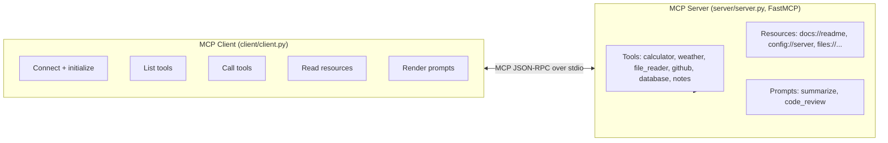

# mcp-server-client

A full **Model Context Protocol (MCP)** implementation — a server that exposes
tools, resources, and reusable prompt templates, plus a client that connects,
discovers, and invokes them. The goal is to understand MCP end-to-end: how a
server advertises capabilities and how a client discovers and calls them.

> **Status: working.** Built on the official `mcp` Python SDK (FastMCP). All six
> tools, three resources and two prompts are implemented, and there is a client
> that does a real stdio round trip against the server. Verified on Python 3.14
> with `pytest` (39 tests passing, including a live client↔server stdio smoke
> test). Everything runs **offline with no API keys** — tools that could hit a
> network default to deterministic local stubs.

---

## Architecture Diagram



The client **spawns the server as a subprocess** and talks to it over stdio —
that is how the MCP stdio transport works, so there is no network port to open.

---

## Folder Structure

```
mcp-server-client/
├── server/
│   ├── server.py              # FastMCP server entrypoint (wires everything)
│   ├── tools/                 # one module per tool (pure logic + register())
│   │   ├── calculator.py      # safe AST-based arithmetic (no eval)
│   │   ├── weather.py         # deterministic offline stub; live API optional
│   │   ├── file_reader.py     # sandboxed reads; blocks path traversal
│   │   ├── github.py          # offline repo-info stub; live API optional
│   │   ├── database.py        # SQLite records store (in-memory by default)
│   │   └── notes.py           # in-memory notes CRUD
│   ├── resources/resources.py # README / config / files as MCP resources
│   ├── prompts/prompts.py     # summarize / code_review prompt templates
│   ├── requirements.txt
│   └── Dockerfile
├── client/
│   ├── client.py              # connect / list / call / read / render demo
│   └── requirements.txt
├── tests/                     # pytest suite (pure logic + stdio round trip)
├── data/                      # sandbox root for the file_reader tool
├── config/config.example.json # copy to config.json to add real API keys
├── Dockerfile                 # full-demo image (client spawns server)
├── docker-compose.yml
├── .gitignore
├── LICENSE
└── README.md
```

---

## Run locally (verified)

Requires Python 3.11+ (built and tested on 3.14).

```bash
# 1. Create a virtualenv and install the server + test deps
python3 -m venv .venv
source .venv/bin/activate
pip install -r server/requirements.txt pytest

# 2. Run the test suite (39 tests: tool logic + a live stdio round trip)
python -m pytest -q

# 3. Run the end-to-end client demo
#    (the client launches `python -m server.server` for you)
python -m client.client
```

The demo prints the full lifecycle: connect → list tools → call the calculator →
list/read a resource → list/render a prompt.

### Running the server on its own

The server speaks MCP over stdio, so it is normally launched *by* a client (our
client, Claude Desktop, or any MCP host). To register it with an MCP host, point
the host at:

```
command: python
args:    ["-m", "server.server"]
cwd:     <path to this repo>
```

### With Docker

> Docker was **not available** in the environment this was built in, so the image
> is provided correct-but-unrun. On a machine with Docker:

```bash
docker compose up   # builds the image and runs the client demo
```

### Optional real APIs (off by default)

| Env var           | Enables                                   |
|-------------------|-------------------------------------------|
| `WEATHER_API_KEY` | live weather lookup (else offline stub)   |
| `GITHUB_TOKEN`    | live GitHub repo info (else offline stub) |

Without these, every tool still works using deterministic local data.

---

## Features

- **Tools** (`@mcp.tool()`):
  - `calculator` — safe arithmetic via AST parsing (never `eval`).
  - `weather` — deterministic offline weather; optional live API.
  - `file_reader` / `file_list` — reads inside a sandbox; blocks `..`, absolute
    paths and symlink escapes.
  - `github` — basic public repo info; offline stub by default.
  - `db_insert` / `db_query` — SQLite records store, parameterised (injection-safe).
  - `notes_create/list/read/update/delete` — in-memory notes CRUD.
- **Resources** (`@mcp.resource()`): `docs://readme`, `config://server`
  (secrets redacted), `files://list` and the templated `files://{name}`.
- **Prompts** (`@mcp.prompt()`): `summarize`, `code_review`.
- **Client**: connects over stdio, lists and calls tools, reads resources, and
  renders prompts. Falls back to an in-process demo if the SDK is missing.

---

## API Documentation

### Tools

| Tool | Arguments | Returns |
|------|-----------|---------|
| `calculator` | `expression: str` | `"<expr> = <result>"` |
| `weather` | `city: str` | weather dict (`temperature_c`, `condition`, …) |
| `file_reader` | `relative_path: str` | file contents (sandboxed) |
| `file_list` | — | list of files in the sandbox |
| `github` | `owner: str, repo: str` | repo info dict (`stars`, `forks`, …) |
| `db_insert` | `category: str, content: str` | `{id, category, content}` |
| `db_query` | `category: str = None` | list of record dicts |
| `notes_create` | `text: str` | `{id, text}` |
| `notes_list` | — | list of `{id, text}` |
| `notes_read` | `note_id: int` | `{id, text}` |
| `notes_update` | `note_id: int, text: str` | `{id, text}` |
| `notes_delete` | `note_id: int` | `{deleted: id}` |

### Resources

| URI | Description |
|-----|-------------|
| `docs://readme` | This README, as text/markdown |
| `config://server` | Effective config as JSON, secrets redacted |
| `files://list` | JSON list of sandboxed files |
| `files://{name}` | Contents of a single sandboxed file |

### Prompts

| Prompt | Arguments |
|--------|-----------|
| `summarize` | `text: str, style: str = "concise"` |
| `code_review` | `code: str, language: str = "python"` |

Under the hood these are standard MCP JSON-RPC methods: `tools/list`,
`tools/call`, `resources/list`, `resources/read`, `prompts/list`, `prompts/get`.

---

## Screenshots / Demo GIF

Not captured (this is a headless CLI project). The `python -m client.client`
output shown under "Run locally" is the demo; capturing a terminal GIF is left as
a future improvement.

---

## Future Improvements

- Add a streaming/long-running tool that emits `ctx.report_progress(...)` so the
  client can demonstrate progress notifications (the current tools return in one
  shot).
- Optional persistent SQLite file for the database/notes tools.
- Capture a terminal demo GIF and screenshots.
- CI workflow to run the pytest suite on push.

---

## License

Released under the [MIT License](./LICENSE). Copyright (c) 2026 ranjan-del.
